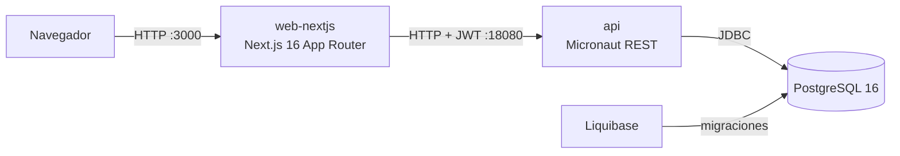

# BirApp

**Banco de preguntas tipo test para preparar las oposiciones MIR, EIR, BIR, FIR, PIR, QIR y RFIR.**

BirApp reúne en un mismo sitio el banco de preguntas, la práctica libre, los simulacros y las
estadísticas de cada persona. Su arquitectura combina un backend REST en
[Micronaut](https://micronaut.io/) (`api`, Java 21) y un frontend moderno en
[Next.js 16](https://nextjs.org/) (`web-nextjs`, App Router, React 19 y Tailwind CSS v4), con
PostgreSQL 16 y migraciones gestionadas con Liquibase, todo empaquetado en imágenes Docker listas
para desplegar.

[](https://github.com/ajiniesta/bir-app/actions/workflows/ci.yml)


> **⚠️ Aviso sobre el módulo `web` (Micronaut + Thymeleaf):**
> El proyecto web antiguo en Micronaut/Thymeleaf (`web/`, puerto `8081`) está **obsoleto** y no se
> actualizarán nuevas funcionalidades dentro de él. El proyecto oficial de frontend es
> **`web-nextjs`** (Next.js 16 App Router, puerto `3000`).

---

## Índice

- [¿Qué es BirApp?](#qué-es-birapp)
- [Qué puedes hacer](#qué-puedes-hacer)
- [Cómo funciona](#cómo-funciona)
- [Arranque rápido con Docker](#arranque-rápido-con-docker)
- [Imágenes publicadas](#imágenes-publicadas)
- [Las tres formas de levantar el stack](#las-tres-formas-de-levantar-el-stack)
- [Desarrollo local](#desarrollo-local)
- [Tests](#tests)
- [Estructura del repositorio](#estructura-del-repositorio)
- [API de un vistazo](#api-de-un-vistazo)
- [CI/CD](#cicd)
- [Próximos pasos](#próximos-pasos)
- [Documentación para desarrolladores](#documentación-para-desarrolladores)

---

## ¿Qué es BirApp?

Preparar una oposición sanitaria es responder muchas preguntas, repasar las que fallas y
acostumbrarte al ritmo de un examen real. BirApp cubre ese ciclo:

1. **Estudiar** con sesiones de preguntas aleatorias (modo libre) o con simulacros completos.
2. **Corregir** al instante en modo libre, o al entregar el simulacro, con la explicación de cada
   pregunta.
3. **Medir** el progreso con estadísticas personales por tipo de examen, por categoría y por
   simulacro.
4. **Mejorar el banco**: cualquier usuario puede proponer una corrección de respuesta y el equipo
   creador la revisa.

El banco está organizado por **tipo de examen** (`exam_type`): MIR, EIR, BIR, FIR, PIR, QIR y
RFIR. Cada pregunta tiene enunciado, cuatro opciones (A–D), una única respuesta correcta,
categoría, tag y explicación opcional.

## Qué puedes hacer

### Estudiar

- **Modo libre** (`/free`): elige banco, categoría, tag y número de preguntas; se seleccionan al
  azar y respondes de una en una, con corrección y explicación inmediatas.
- **Simulacros** (`/simulacros`): colecciones fijas y ordenadas de preguntas de un mismo banco
  (hasta 210 preguntas: 200 + 10 de reserva), creadas por el equipo. Se responden en modo examen
  (sin pistas), se pueden cambiar respuestas, guardar progreso y entregar cuando quieras. Intentos
  ilimitados, con historial y comparativa de notas.
- **Estadísticas** (`/estadisticas`): partidas, preguntas respondidas, acertadas, porcentaje de
  acierto y desglose por tipo de examen; barras de progreso y tabla por categoría (modo libre +
  simulacros entregados), incluyendo las categorías que aún no has practicado. Los administradores y
  creadores ven además las estadísticas globales y el desglose por usuario. En simulacros: nota
  media, mejor nota e historial por simulacro.
- **Estadísticas por pregunta (popup concéntrico)**: al visualizar una pregunta, un botón abre un
  popup con las veces que se ha respondido y su porcentaje de acierto tanto en toda la plataforma
  como por el usuario autenticado, acompañado de dos gráficos de tarta concéntricos (interior:
  usuario; exterior: toda la plataforma).
- **Impresión / PDF de simulacros** (`/simulacros/[id]/pdf`): vista optimizada para impresión y
  guardado en PDF (preguntas, opciones sin revelar la respuesta correcta y hoja de respuestas final)
  para practicar en papel.
- **Propuestas de respuesta**: si crees que una pregunta está mal, puedes proponer otra opción
  y/o un texto alternativo, con un motivo, desde la pantalla de corrección de modo libre o la
  revisión del simulacro.
- **Perfil y tema claro/oscuro** (`/profile`): consulta de datos de la cuenta, cambio de contraseña
  y selector de tema claro/oscuro persistente en toda la interfaz.

### Crear contenido

- CRUD de preguntas (`/questions`) con validación de **exactamente una opción correcta**.
- Buscador paginado por texto, banco, categoría y tag.
- **Importación masiva** (`/questions/import`) desde un archivo JSON (varios objetos concatenados o
  un array), dividida en lotes desde el navegador con barra de progreso en tiempo real. Las
  preguntas válidas se guardan, las defectuosas se reportan y los duplicados se omiten (re-subir un
  archivo interrumpido retoma la importación).
- **Detección y limpieza de duplicados** (`/questions/duplicates`): mismo banco, mismo enunciado y
  mismas opciones. Conserva la versión más completa y re-apunta el historial antes de borrar por
  lotes.

### Administrar

- Tres roles: **ADMIN** (todo, incluida la gestión de usuarios), **CREATOR** (contenido,
  simulacros y revisiones) y **USER** (solo practicar en los bancos que le asignen).
- Asignación de bancos por usuario y cambio de rol (`/admin/users`).
- Bandeja de revisión de propuestas (`/revisiones`) filtrable por estado y banco. Aceptar una
  propuesta aplica el cambio a la pregunta en el momento.

## Cómo funciona



| Módulo | Estado | Qué hace | Puerto |
|--------|--------|----------|--------|
| `api` | **Activo** | Backend REST en Micronaut: entidades JPA, servicios, seguridad JWT y lógica de negocio | `18080` |
| `web-nextjs` | **Activo** | **Frontend principal** en Next.js 16 (App Router, React 19, Tailwind CSS v4, NextAuth v5); actúa como proxy en runtime hacia `api` | `3000` |
| `db-migrations` | **Activo** | Changelogs de Liquibase (esquema + datos de ejemplo) | — |
| `web` | **Obsoleto** | Antiguo frontend server-side con Micronaut + Thymeleaf. **No se actualizarán nuevas funcionalidades dentro** | `8081` |

La `api` es la autoridad: guarda los usuarios, emite el JWT y aplica los permisos. `web-nextjs`
autentica contra la `api` mediante NextAuth v5 (proveedor `Credentials`), almacena el JWT en la
sesión cifrada y reenvía `Authorization: Bearer` en las peticiones al backend.

## Arranque rápido con Docker

La forma más rápida de ver la aplicación funcionando es usar las **imágenes publicadas en GitHub
Container Registry** con [`docker/docker-compose.yml`](docker/docker-compose.yml):

```bash
git clone https://github.com/ajiniesta/bir-app.git
cd bir-app

docker compose -f docker/docker-compose.yml pull
docker compose -f docker/docker-compose.yml up -d
```

Abre **<http://localhost:3000/>** (frontend `web-nextjs`). La API queda en
**<http://localhost:18080/api/stats>** (healthcheck en `/api/health`).

> El compose monta el changelog de `db-migrations/` desde el repositorio para que Liquibase cree
> el esquema, así que hay que lanzarlo desde un clon del proyecto (no hace falta compilar nada).
> La primera vez tarda un poco: PostgreSQL arranca, las migraciones se aplican y luego levantan
> `api` y `web-nextjs`.

Usuarios de ejemplo (contexto `seed`):

| Usuario | Contraseña | Rol |
|---------|------------|-----|
| `admin` | `admin1234` | ADMIN |
| `demo`  | `demo1234`  | CREATOR |

Para parar el stack:

```bash
docker compose -f docker/docker-compose.yml down       # conserva los datos
docker compose -f docker/docker-compose.yml down -v    # borra también el volumen de PostgreSQL
```

### Configuración

Las variables son opcionales y tienen valores por defecto para local. Si quieres cambiarlas, crea
un archivo `docker/.env` (el compose lo lee del directorio del propio archivo):

```dotenv
DB_USERNAME=bir_app
DB_PASSWORD=cambia-esta-clave
JWT_SECRET=cambia-este-secreto-largo-y-aleatorio
```

| Variable | Servicio | Por defecto |
|----------|----------|-------------|
| `DB_USERNAME` | PostgreSQL, API | `bir_app` |
| `DB_PASSWORD` | PostgreSQL, API | `bir_app_secret` |
| `JWT_SECRET` | API, `web-nextjs` (`AUTH_SECRET`) | secreto de ejemplo |
| `API_BASE_URL` | `web-nextjs` | `http://api:18080` (resuelto en runtime y fijado en el compose) |

## Imágenes publicadas

Cada push a `main` publica las imágenes en **GitHub Container Registry**:

| Imagen | Contenido | Puerto |
|--------|-----------|--------|
| [`ghcr.io/ajiniesta/bir-app/web-nextjs`](https://github.com/ajiniesta/bir-app/pkgs/container/bir-app%2Fweb-nextjs) | **Frontend principal** (Next.js 16 App Router standalone) | `3000` |
| [`ghcr.io/ajiniesta/bir-app/api`](https://github.com/ajiniesta/bir-app/pkgs/container/bir-app%2Fapi) | API REST (Micronaut sobre JVM Temurin 21, JWT) | `18080` |
| [`ghcr.io/ajiniesta/bir-app/api-graalvm`](https://github.com/ajiniesta/bir-app/pkgs/container/bir-app%2Fapi-graalvm) | API REST compilada a binario nativo con GraalVM Native Image (`-march=compatibility`, arranque instantáneo y bajo consumo de RAM) | `18080` |
| [`ghcr.io/ajiniesta/bir-app/web`](https://github.com/ajiniesta/bir-app/pkgs/container/bir-app%2Fweb) | ⚠️ *Obsoleto* — Antigua interfaz web (Micronaut + Thymeleaf, sin nuevas funcionalidades) | `8081` |

También están listadas en la página de paquetes del repositorio:
**<https://github.com/ajiniesta?tab=packages&repo_name=bir-app>**.

Etiquetas disponibles: `latest`, `main` y `sha-<commit>` (por ejemplo `sha-b889c8f`). Para fijar
una versión concreta en producción, usa la etiqueta `sha-…` en lugar de `latest`.

```bash
docker pull ghcr.io/ajiniesta/bir-app/api:latest
docker pull ghcr.io/ajiniesta/bir-app/web-nextjs:latest
```

Las imágenes son públicas: no hace falta iniciar sesión para descargarlas. Si haces un fork y
publicas las tuyas en un repositorio privado, autentícate con un token que tenga `read:packages`:

```bash
echo "$GITHUB_TOKEN" | docker login ghcr.io -u TU_USUARIO --password-stdin
```

Las imágenes se pueden usar en tu propio `docker-compose.yml` (añadiendo PostgreSQL y el
contenedor de migraciones):

```yaml
services:
  api:
    image: ghcr.io/ajiniesta/bir-app/api:latest
    environment:
      DB_URL: jdbc:postgresql://postgres:5432/bir_app
      DB_USERNAME: bir_app
      DB_PASSWORD: bir_app_secret
      JWT_SECRET: cambia-este-secreto
    ports:
      - "18080:18080"

  web-nextjs:
    image: ghcr.io/ajiniesta/bir-app/web-nextjs:latest
    environment:
      API_BASE_URL: http://api:18080
      AUTH_SECRET: cambia-este-secreto
    ports:
      - "3000:3000"
```

El compose listo para usar, con PostgreSQL, el contenedor de migraciones y límites de memoria
ajustados para servidores ligeros o NAS, está en [`docker/docker-compose.yml`](docker/docker-compose.yml).

## Las tres formas de levantar el stack

| Archivo | Para qué | Cómo |
|---------|----------|------|
| [`docker/docker-compose.yml`](docker/docker-compose.yml) | Stack completo (`postgres` + `migrations` + `api` + `web-nextjs` en `:3000`) con las **imágenes publicadas** en GHCR y límites de RAM optimizados. Recomendado para probar o desplegar sin compilar. | `docker compose -f docker/docker-compose.yml up -d` |
| [`docker-compose.full.yml`](docker-compose.full.yml) | Stack completo **construyendo las imágenes en local** (útil si estás tocando el código o ejecutando el smoke test de CI). | `docker compose -f docker-compose.full.yml up -d --build` |
| [`docker-compose.yml`](docker-compose.yml) | Solo **PostgreSQL** en el puerto `5434`, para desarrollo local con Maven (`mvn mn:run -pl api`) y Node (`npm run dev`). | `docker compose up -d` |

El compose de desarrollo es independiente (proyecto propio y volumen `pgdata`). Los dos stacks
completos comparten el nombre de proyecto `bir-app-full` y el volumen `pgdata-full`: son dos
alternativas para el mismo despliegue, no están pensados para correr a la vez.

Servicios del stack completo:

```text
postgres  →  migrations (Liquibase, termina y sale)  →  api (:18080)  →  web-nextjs (:3000)
```

## Desarrollo local

Requisitos: **Java 21**, **Maven 3.9+**, **Node.js 20+** y **Docker**.

```bash
# 1. PostgreSQL en localhost:5434
docker compose up -d

# 2. Esquema + datos de ejemplo (bancos, admin y demo)
mvn liquibase:update -pl db-migrations -Dliquibase.contexts=seed

# 3. Compilar backend Java
mvn compile

# 4. Arrancar la API REST (en una terminal)
mvn mn:run -pl api     # http://localhost:18080

# 5. Arrancar el frontend Next.js (en otra terminal)
cd web-nextjs
npm install
npm run dev            # http://localhost:3000
```

Abre **<http://localhost:3000/>** e inicia sesión con `admin / admin1234`.

Notas rápidas:

- El esquema se gestiona **solo con Liquibase** (`hbm2ddl.auto=none`); JPA nunca crea tablas.
- `web-nextjs` resuelve `API_BASE_URL` en **runtime** (por defecto `http://localhost:18080`) a
  través de sus Route Handlers (`app/api/[...path]/route.ts`).
- Si cambias una migración, vuelve a ejecutar `mvn liquibase:update -pl db-migrations`.
- El módulo `web` (Micronaut + Thymeleaf en `:8081`) está **obsoleto**: no hace falta arrancarlo
  para desarrollar ni recibirá nuevas funcionalidades.

## Tests

```bash
# Backend y módulos Java (JUnit 5 + Mockito + AssertJ)
mvn verify              # todo el proyecto Maven (lo mismo que ejecuta la CI)
mvn -pl api test        # solo la API REST

# Frontend Next.js (Jest 30 + React Testing Library)
cd web-nextjs
npm test                # ejecuta las 27 suites de tests de componentes, páginas y proxy
```

- `api`: tests unitarios y de controladores con JUnit 5, Mockito y AssertJ (servicios,
  controladores de perfil/salud/auth/admin, importación, duplicados, seguridad y manejo de errores).
- `web-nextjs`: 27 suites de tests en `web-nextjs/__tests__/` con Jest 30 (`jest-environment-jsdom`)
  y React Testing Library que cubren todas las vistas, formularios, navegación, selector de tema,
  cambio de contraseña, modo libre, simulacros, estadísticas, importación, duplicados, revisiones,
  administración y proxy de API.
- `web` *(obsoleto)*: tests legacy de regresión en `web/src/test/`.

Ningún test toca la base de datos de desarrollo.

## Estructura del repositorio

```text
bir-app/
├── api/                  # Backend Micronaut (REST + JPA + JWT, puerto 18080)
│   ├── src/main/java/bir/app/api/
│   │   ├── controller/   # Endpoints REST (Auth, Profile, Questions, Free, MockExam, Stats, Admin, Health…)
│   │   ├── service/      # Lógica de negocio
│   │   ├── entity/       # Entidades JPA
│   │   ├── repository/   # Repositorios Micronaut Data
│   │   └── security/     # Autenticación y BCrypt
│   ├── Dockerfile        # Imagen JVM (Eclipse Temurin 21)
│   └── Dockerfile.graalvm # Imagen nativa GraalVM 21 (-march=compatibility)
├── web-nextjs/           # Frontend principal en Next.js 16 App Router (puerto 3000)
│   ├── app/              # Rutas App Router, Server/Client Components y Route Handlers (/api/...)
│   ├── __tests__/        # Suites de tests con Jest 30 y React Testing Library
│   ├── auth.ts           # Configuración de NextAuth v5 (Credentials + JWT)
│   └── Dockerfile        # Imagen standalone sobre Node 20 Alpine
├── db-migrations/        # Changelogs de Liquibase
├── web/                  # [OBSOLETO] Antiguo frontend Micronaut + Thymeleaf (sin nuevas funcionalidades)
├── docker/               # Compose de despliegue con las imágenes publicadas en GHCR
├── docker-compose.yml    # PostgreSQL para desarrollo local (puerto 5434)
├── docker-compose.full.yml # Stack completo construido en local
└── AGENTS.md             # Documentación técnica detallada y arquitectura
```

## API de un vistazo

La API expone JSON en `http://localhost:18080`. Los grupos principales:

| Prefijo | Contenido |
|---------|-----------|
| `/api/health` | Comprobación de salud pública (`{"status": "UP"}`) |
| `/login`, `/api/auth` | Autenticación (JWT) y registro |
| `/api/profile/password` | Cambio de contraseña del usuario autenticado |
| `/api/questions` | CRUD, búsqueda paginada, categorías, importación por lotes y duplicados |
| `/api/tags`, `/api/exam-types` | Tags y bancos de preguntas disponibles |
| `/api/free-sessions` | Sesiones de estudio en modo libre |
| `/api/mock-exams`, `/api/mock-exam-attempts` | Simulacros e intentos |
| `/api/proposals` | Propuestas de respuesta y bandeja de revisión |
| `/api/stats` | Estadísticas públicas, personales, de simulacros y globales (ADMIN/CREATOR) |
| `/api/admin/users` | Gestión de usuarios, roles y bancos asignados (ADMIN) |

Todo está autenticado por defecto salvo `GET /api/health`, `POST /login`,
`POST /api/auth/register` y `GET /api/stats`. El detalle de cada endpoint, los permisos y el modelo
de datos está en [`AGENTS.md`](AGENTS.md).

## CI/CD

El pipeline de GitHub Actions ([`.github/workflows/ci.yml`](.github/workflows/ci.yml)) tiene tres
trabajos:

1. **Compilar y testear** en cada push y pull request: `mvn -B -ntp verify` para los módulos Java y
   `npm ci && npm test && npm run build` para `web-nextjs`.
2. **Publicar imágenes** solo en `main`: construye `api`, `api-graalvm`, `web-nextjs` (y la imagen
   legacy `web`) y las sube a GHCR con las etiquetas `main`, `latest` y `sha-<commit>`.
3. **Smoke test** solo en `main`: levanta el stack completo con `docker-compose.full.yml`,
   comprueba `GET /api/stats`, verifica la autenticación y valida que `web-nextjs` responde en
   `:3000`.

## Próximos pasos

Ideas apuntadas para seguir mejorando la app (todas sobre `api` y `web-nextjs`):

- Puntuación de simulacro estilo oposición (1 punto por acierto, −1/3 por fallo).
- Preferencias de estudio personalizadas y filtros favoritos en el perfil de usuario (`/profile`).

## Documentación para desarrolladores

[`AGENTS.md`](AGENTS.md) es la referencia técnica completa: modelo de datos, reglas de negocio,
tabla de endpoints de `api`, mapa completo de rutas de `web-nextjs`, aviso de obsolescencia del
módulo `web`, importación, duplicados, propuestas y detalles de despliegue.

¿Encuentras un fallo o quieres proponer una mejora? Abre un
[issue](https://github.com/ajiniesta/bir-app/issues) o un pull request.
