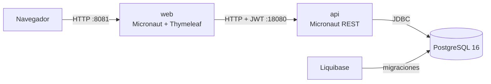

# BirApp

**Banco de preguntas tipo test para preparar las oposiciones MIR, EIR, BIR, FIR, PIR, QIR y RFIR.**

BirApp reúne en un mismo sitio el banco de preguntas, la práctica libre, los simulacros y las
estadísticas de cada persona. Detrás hay dos aplicaciones [Micronaut](https://micronaut.io/)
(API + web), PostgreSQL y migraciones con Liquibase, todo empaquetado en imágenes Docker listas
para usar.

[](https://github.com/ajiniesta/bir-app/actions/workflows/ci.yml)


---

## Índice

- [¿Qué es BirApp?](#qué-es-birapp)
- [Qué puedes hacer](#qué-puedes-hacer)
- [Cómo funciona](#cómo-funciona)
- [Arranque rápido con Docker](#arranque-rápido-con-docker)
- [Imágenes publicadas](#imágenes-publicadas)
- [Las tres formas de levantar el stack](#las-tres-formas-de-levantar-el-stack)
- [Desarrollo local](#desarrollo-local)
- [Tests](#tests)
- [Estructura del repositorio](#estructura-del-repositorio)
- [API de un vistazo](#api-de-un-vistazo)
- [CI/CD](#cicd)
- [Próximos pasos](#próximos-pasos)
- [Documentación para desarrolladores](#documentación-para-desarrolladores)

---

## ¿Qué es BirApp?

Preparar una oposición sanitaria es responder muchas preguntas, repasar las que fallas y
acostumbrarte al ritmo de un examen real. BirApp cubre ese ciclo:

1. **Estudiar** con sesiones de preguntas aleatorias (modo libre) o con simulacros completos.
2. **Corregir** al instante en modo libre, o al entregar el simulacro, con la explicación de cada
   pregunta.
3. **Medir** el progreso con estadísticas personales por tipo de examen y por simulacro.
4. **Mejorar el banco**: cualquier usuario puede proponer una corrección de respuesta y el equipo
   creador la revisa.

El banco está organizado por **tipo de examen** (`exam_type`): MIR, EIR, BIR, FIR, PIR, QIR y
RFIR. Cada pregunta tiene enunciado, cuatro opciones (A–D), una única respuesta correcta,
categoría, tag y explicación opcional.

## Qué puedes hacer

### Estudiar

- **Modo libre**: elige banco, categoría, tag y número de preguntas; se seleccionan al azar y
  respondes de una en una, con corrección y explicación inmediatas.
- **Simulacros**: colecciones fijas y ordenadas de preguntas de un mismo banco, creadas por el
  equipo. Se responden en modo examen (sin pistas), se pueden cambiar respuestas, guardar
  progreso y entregar cuando quieras. Intentos ilimitados, con historial y comparativa de notas.
- **Estadísticas**: partidas, preguntas respondidas, acertadas, porcentaje de acierto y desglose
  por tipo de examen; en simulacros, nota media, mejor nota e historial por simulacro.
- **PDF de simulacros**: cada simulacro se puede descargar en PDF (preguntas, opciones, hoja de
  respuestas) para practicar en papel.
- **Propuestas de respuesta**: si crees que una pregunta está mal, puedes proponer otra opción
  y/o un texto alternativo, con un motivo, desde la pantalla de corrección.

### Crear contenido

- CRUD de preguntas con validación de **exactamente una opción correcta**.
- Buscador paginado por texto, banco, categoría y tag.
- **Importación masiva** desde un archivo JSON (varios objetos concatenados o un array), por
  lotes y con barra de progreso. Las preguntas válidas se guardan, las defectuosas se reportan y
  los duplicados se omiten (re-subir un archivo interrumpido retoma la importación).
- **Detección y limpieza de duplicados**: mismo banco, mismo enunciado y mismas opciones.
  Conserva la versión más completa y re-apunta el historial antes de borrar.

### Administrar

- Tres roles: **ADMIN** (todo, incluida la gestión de usuarios), **CREATOR** (contenido y
  simulacros) y **USER** (solo practicar en los bancos que le asignen).
- Asignación de bancos por usuario y cambio de rol.
- Bandeja de revisión de propuestas (`/revisiones`), con contador de pendientes en el menú.
  Aceptar una propuesta aplica el cambio a la pregunta en el momento.

## Cómo funciona



| Módulo | Qué hace | Puerto |
|--------|----------|--------|
| `api` | Backend REST: entidades JPA, servicios, seguridad JWT y lógica de negocio | `18080` |
| `web` | Frontend server-side con Thymeleaf; nunca habla con la base de datos, llama a `api` | `8081` |
| `db-migrations` | Changelogs de Liquibase (esquema + datos de ejemplo) | — |

La `api` es la autoridad: guarda los usuarios, emite el JWT y aplica los permisos. La `web`
autentica contra la `api`, guarda el token en la sesión y lo reenvía en cada llamada.

## Arranque rápido con Docker

La forma más rápida de ver la aplicación funcionando es usar las **imágenes publicadas en GitHub
Container Registry** con [`docker/docker-compose.yml`](docker/docker-compose.yml):

```bash
git clone https://github.com/ajiniesta/bir-app.git
cd bir-app

docker compose -f docker/docker-compose.yml pull
docker compose -f docker/docker-compose.yml up -d
```

Abre **<http://localhost:8081/>**. La API queda en **<http://localhost:18080/api/stats>**.

> El compose monta el changelog de `db-migrations/` desde el repositorio para que Liquibase cree
> el esquema, así que hay que lanzarlo desde un clon del proyecto (no hace falta compilar nada).
> La primera vez tarda un poco: PostgreSQL arranca, las migraciones se aplican y luego levantan
> `api` y `web`.

Usuarios de ejemplo (contexto `seed`):

| Usuario | Contraseña | Rol |
|---------|------------|-----|
| `admin` | `admin1234` | ADMIN |
| `demo`  | `demo1234`  | CREATOR |

Para parar el stack:

```bash
docker compose -f docker/docker-compose.yml down       # conserva los datos
docker compose -f docker/docker-compose.yml down -v    # borra también el volumen de PostgreSQL
```

### Configuración

Las variables son opcionales y tienen valores por defecto para local. Si quieres cambiarlas, crea
un archivo `docker/.env` (el compose lo lee del directorio del propio archivo):

```dotenv
DB_USERNAME=bir_app
DB_PASSWORD=cambia-esta-clave
JWT_SECRET=cambia-este-secreto-largo-y-aleatorio
```

| Variable | Servicio | Por defecto |
|----------|----------|-------------|
| `DB_USERNAME` | PostgreSQL, API | `bir_app` |
| `DB_PASSWORD` | PostgreSQL, API | `bir_app_secret` |
| `JWT_SECRET` | API | secreto de ejemplo |
| `API_BASE_URL` | Web | `http://api:18080` (ya fijado en el compose) |

## Imágenes publicadas

Cada push a `main` publica dos imágenes en **GitHub Container Registry**:

| Imagen | Contenido | Puerto |
|--------|-----------|--------|
| [`ghcr.io/ajiniesta/bir-app/api`](https://github.com/ajiniesta/bir-app/pkgs/container/bir-app%2Fapi) | API REST (Micronaut, JWT) | `18080` |
| [`ghcr.io/ajiniesta/bir-app/web`](https://github.com/ajiniesta/bir-app/pkgs/container/bir-app%2Fweb) | Interfaz web (Micronaut + Thymeleaf) | `8081` |

También están listadas en la página de paquetes del repositorio:
**<https://github.com/ajiniesta?tab=packages&repo_name=bir-app>**.

Etiquetas disponibles: `latest`, `main` y `sha-<commit>` (por ejemplo `sha-a07d1b9`). Para fijar
una versión concreta en producción, usa la etiqueta `sha-…` en lugar de `latest`.

```bash
docker pull ghcr.io/ajiniesta/bir-app/api:latest
docker pull ghcr.io/ajiniesta/bir-app/web:latest
```

Las imágenes son públicas: no hace falta iniciar sesión para descargarlas. Si haces un fork y
publicas las tuyas en un repositorio privado, autentícate con un token que tenga `read:packages`:

```bash
echo "$GITHUB_TOKEN" | docker login ghcr.io -u TU_USUARIO --password-stdin
```

Las dos imágenes se pueden usar en tu propio `docker-compose.yml` (añadiendo PostgreSQL y el
contenedor de migraciones):

```yaml
services:
  api:
    image: ghcr.io/ajiniesta/bir-app/api:latest
    environment:
      DB_URL: jdbc:postgresql://postgres:5432/bir_app
      DB_USERNAME: bir_app
      DB_PASSWORD: bir_app_secret
      JWT_SECRET: cambia-este-secreto
    ports:
      - "18080:18080"

  web:
    image: ghcr.io/ajiniesta/bir-app/web:latest
    environment:
      API_BASE_URL: http://api:18080
    ports:
      - "8081:8081"
```

El compose listo para usar, con PostgreSQL y el contenedor de migraciones incluidos, está en
[`docker/docker-compose.yml`](docker/docker-compose.yml); puedes copiarlo como punto de partida.

## Las tres formas de levantar el stack

| Archivo | Para qué | Cómo |
|---------|----------|------|
| [`docker/docker-compose.yml`](docker/docker-compose.yml) | Stack completo con las **imágenes publicadas** en GHCR. Es el recomendado para probar o desplegar sin compilar. | `docker compose -f docker/docker-compose.yml up -d` |
| [`docker-compose.full.yml`](docker-compose.full.yml) | Stack completo **construyendo las imágenes en local** (útil si estás tocando el código). | `docker compose -f docker-compose.full.yml up -d --build` |
| [`docker-compose.yml`](docker-compose.yml) | Solo **PostgreSQL** en el puerto `5434`, para desarrollo con Maven (`mvn mn:run`). | `docker compose up -d` |

El compose de desarrollo es independiente (proyecto propio y volumen `pgdata`). Los dos stacks
completos comparten el nombre de proyecto `bir-app-full` y el volumen `pgdata-full`: son dos
alternativas para el mismo despliegue, no están pensados para correr a la vez.

Servicios del stack completo:

```text
postgres  →  migrations (Liquibase, termina y sale)  →  api  →  web
```

`api` y `web` esperan a que el servicio anterior esté sano, y ambos tienen `healthcheck`.

## Desarrollo local

Requisitos: **Java 21**, **Maven 3.9+** y **Docker**.

```bash
# 1. PostgreSQL en localhost:5434
docker compose up -d

# 2. Esquema + datos de ejemplo (bancos, admin y demo)
mvn liquibase:update -pl db-migrations -Dliquibase.contexts=seed

# 3. Compilar todo
mvn compile

# 4. Arrancar cada aplicación en su propia terminal
mvn mn:run -pl api     # http://localhost:18080
mvn mn:run -pl web     # http://localhost:8081
```

Abre <http://localhost:8081/> e inicia sesión con `admin / admin1234`.

Notas rápidas:

- El esquema se gestiona **solo con Liquibase** (`hbm2ddl.auto=none`); JPA nunca crea tablas.
- La `web` se configura con `api.base-url` (por defecto `http://localhost:18080`).
- Si cambias una migración, vuelve a ejecutar `mvn liquibase:update -pl db-migrations`.

## Tests

```bash
mvn verify              # todo el proyecto (lo mismo que ejecuta la CI)
mvn -pl api test        # solo la API
mvn -pl web test        # solo la web
```

- `api`: tests unitarios con JUnit 5, Mockito y AssertJ (servicios, importación, duplicados,
  seguridad, manejo de errores).
- `web`: tests unitarios (formularios, PDF, filtros de autenticación, navegación) y tests HTTP con
  `@MicronautTest` que hacen peticiones reales contra la app en un puerto aleatorio.

Ningún test toca la base de datos de desarrollo.

## Estructura del repositorio

```text
bir-app/
├── api/                  # Backend Micronaut (REST + JPA + JWT)
│   ├── src/main/java/bir/app/api/
│   │   ├── controller/   # Endpoints REST
│   │   ├── service/      # Lógica de negocio
│   │   ├── entity/       # Entidades JPA
│   │   ├── repository/   # Repositorios Micronaut Data
│   │   └── security/     # Autenticación y BCrypt
│   └── Dockerfile
├── web/                  # Frontend Micronaut + Thymeleaf
│   ├── src/main/java/bir/app/web/
│   │   ├── controller/   # Rutas de la interfaz
│   │   ├── client/       # Cliente HTTP de la API
│   │   └── support/      # PDF, importación, navegación
│   ├── src/main/resources/templates/   # Vistas Thymeleaf
│   └── Dockerfile
├── db-migrations/        # Changelogs de Liquibase
├── docker/               # Compose con las imágenes publicadas
├── docker-compose.yml    # PostgreSQL para desarrollo
├── docker-compose.full.yml  # Stack completo construido en local
└── AGENTS.md             # Documentación técnica detallada
```

## API de un vistazo

La API expone JSON en `http://localhost:18080`. Los grupos principales:

| Prefijo | Contenido |
|---------|-----------|
| `/login`, `/api/auth` | Autenticación (JWT) y registro |
| `/api/questions` | CRUD, búsqueda paginada, importación y duplicados |
| `/api/free-sessions` | Modo libre |
| `/api/mock-exams`, `/api/mock-exam-attempts` | Simulacros e intentos |
| `/api/proposals` | Propuestas de respuesta y revisión |
| `/api/stats` | Estadísticas públicas y personales |
| `/api/admin/users` | Usuarios, roles y bancos asignados |

Todo está autenticado por defecto salvo `POST /login`, `POST /api/auth/register` y
`GET /api/stats`. El detalle de cada endpoint, los permisos y el modelo de datos está en
[`AGENTS.md`](AGENTS.md).

## CI/CD

El pipeline de GitHub Actions ([`.github/workflows/ci.yml`](.github/workflows/ci.yml)) tiene tres
trabajos:

1. **Compilar y testear** en cada push y pull request: `mvn -B -ntp verify`.
2. **Publicar imágenes** solo en `main`: construye `api` y `web` y las sube a GHCR con las
   etiquetas `main`, `latest` y `sha-<commit>`.
3. **Smoke test** solo en `main`: levanta el stack completo con `docker-compose.full.yml`,
   comprueba `GET /api/stats` y hace un login real con `admin/admin1234`.

## Próximos pasos

Ideas apuntadas para seguir mejorando la app:

- Gráfico de aciertos por categoría en el panel de estadísticas.
- Puntuación de simulacro estilo oposición (1 punto por acierto, −1/3 por fallo).
- Explorar un frontend más reactivo manteniendo la API actual.

## Documentación para desarrolladores

[`AGENTS.md`](AGENTS.md) es la referencia técnica completa: modelo de datos, reglas de negocio,
tabla de endpoints, rutas web, convenciones de Micronaut, importación, duplicados, propuestas y
detalles de despliegue.

¿Encuentras un fallo o quieres proponer una mejora? Abre un
[issue](https://github.com/ajiniesta/bir-app/issues) o un pull request.
